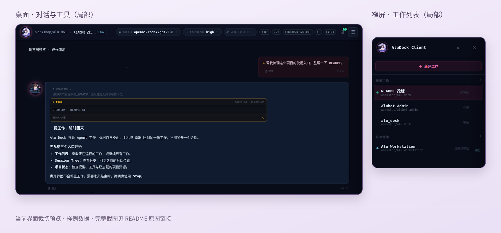

<p align="center">
  
</p>

<h1 align="center">Alu Dock · 阿露 Dock</h1>

<p align="center">
  <strong>工作留在港口，入口随你切换。</strong><br>
  桌面、Android、SSH，回到同一份 Agent 工作。
</p>

<p align="center">
  开始使用：<a href="#linux-host--ssh">Linux / SSH</a> ·
  <a href="#windows-desktop">Windows</a> ·
  <a href="#用手机或远程-desktop-接入">Android / 远程</a><br>
  <a href="#日常使用">日常使用</a> ·
  <a href="#开发与接入">开发与接入</a> ·
  <a href="https://github.com/aruru-project/alu-dock/releases">发行包</a> ·
  <a href="./STORY.md">为什么有它</a>
</p>

---

Alu Dock 是你自己的电脑与工作站上的 **Agent 工作港口**。启动一份工作之后，界面只是入口：你可以离开终端，换到桌面或手机，再回来查看、插句话、接着做。

**不只是断开后继续运行，更重要的是：多个入口看到并操作同一份工作，不会因为换入口另开一份副本。** 下文把这份独立托管的工作叫 **Work**。

当前唯一 Agent 实现是 **Pi**。它在每个 Work 自己的 Worker 进程中运行，保留自己的配置、扩展和原生 Session。Alu Dock 面向本机单用户，也能连接你自己的多台机器；它不是云端多用户平台或通用工作流引擎。

<p align="center">
  <a href="./assets/readme/client-overview.webp">
    
  </a>
</p>

<p align="center">
  <sub>当前官方客户端界面的浏览器设计预览，使用样例数据；不是 Desktop／Android 真机运行截图。</sub><br>
  <sub><a href="./assets/readme/desktop-preview.webp">桌面原图</a> · <a href="./assets/readme/narrow-preview.webp">窄屏原图</a></sub>
</p>

## 能帮你做什么

- **留住工作，随时接手。** 同时推进几个项目，查看各自的运行状态与 Queue；也能通过 Main / SubHost，把你自己的多台机器接到同一入口。
- **继续用 Pi 的能力。** 模型、Thinking、Tools、设置、Session Tree、压缩、扩展交互与项目资源阅读；Pi 的配置和会话仍归 Pi。
- **带入资料，拿走成果。** 上传图片与附件、浏览工作区、下载 Agent 交付文件；明确开启 Dock tools 后，还能让 Agent 帮忙查看其他工作。

各客户端按自己已支持的界面展示能力；一个入口尚未支持的功能，不会因此从 Agent 或其他入口中消失。

## 快速开始

### 先选入口

发行包见 [GitHub Releases](https://github.com/aruru-project/alu-dock/releases)，可用平台与版本以页面实际附件为准。需要自行构建时，见[官方客户端文档](./clients/official/README.md)。

| 使用方式 | 安装或连接方式 | 是否运行本机 Host |
| --- | --- | --- |
| **Linux / SSH** | 从源码安装下方的 Dock Host，运行 `aludock` | 是，使用 `systemd --user` |
| **Linux Desktop · x86_64** | Linux ZIP 中的 `AluDock` 是客户端；另装本机 Host，或连接远程 Host | 按需；ZIP 不包含 Host |
| **Windows Desktop · x86_64** | 使用 `AluDock-<version>-windows-x86_64-Setup.exe` | 默认随客户端启动，也可关闭该选项只连远程 |
| **Android · ARM64** | 安装对应 APK，再与已有 Host 配对 | 否，连接远程 Host |

### Linux Host / SSH

需要 **Node.js ≥ 24.22.1** 和可用的 `systemd --user`。从源码安装：

```bash
git clone https://github.com/aruru-project/alu-dock.git
cd alu-dock
npm ci
npm run install:local
aludock service status
aludock
```

安装会安装或更新当前用户的后台服务，并等待它就绪。找不到 `aludock` 时，检查 `~/.local/bin` 是否在 `PATH` 中；更新前先完成或停止重要工作。

第一次使用，在 Hub 的 **Settings → Pi** 中保存 API key 或完成 OAuth 登录，再选择 **New** 创建工作。创建时可阅读并选择 system（这份 Work 的基础系统提示来源），也可保存为当前目录的默认；已有有效默认时会直接用于创建。

> **需要退出 SSH / 注销后仍常驻？** 由你主动执行 `loginctl enable-linger "$USER"`。仅离开 Work 界面与结束整个用户登录会话不是一回事。安装、更新与资料位置见[本地安装文档](./docs/local-install.md)。

### Windows Desktop

正常退出旧版 Alu Dock 后运行 Setup，按安装器提示安装或更新，再从开始菜单打开 **Alu Dock**。

客户端默认启动本机 Dock。只有启用本机 Host 时才需要 **Node.js ≥ 24.22.1**；在托盘取消“随客户端启动本机 Dock”后，可作为纯客户端连接远程。Pi 随 Alu Dock 提供，不需要另装系统 Pi。

第一次配置 Pi 或连接 SubHost，可从托盘的 **打开终端设置** 进入同一套 Hub 设置。窗口关闭与退出的区别见下方[工作会在什么时候停止](#工作会在什么时候停止)。

### 用手机或远程 Desktop 接入

远程访问**默认关闭**，本机 Desktop 连接不需要配对。

1. 在 Host 本机的 Hub **Devices** 中打开 **Remote Access**，再打开一次五分钟连接窗口。
2. 在远程客户端输入可达的 Host 地址与端口，发起配对。
3. 核对客户端显示的四位 PIN，在本机 Hub 确认。配对后使用双方保存的证书身份连接。

Host 的地址需要能从客户端访问；防火墙与端口映射由你安排。之后换 IP、域名或映射端口，不会改变已经配对的身份。

**多台电脑共同托管工作**是另一条入口：在 Main Hub 的 **Machines** 中连接 SubHost。手机连 Host 与 SubHost 加入 Main 不是同一种配对；具体设置见[多机器部署](./docs/agent_maps/deployment.md#mainsubhost-startup-composition)。

## 日常使用

### 在终端里进入工作

```bash
aludock                         # 打开 Hub，选择工作
aludock -c                      # 继续当前目录最近的工作；没有则新建
aludock new --cwd "$PWD" --name demo
# 关闭弹层、清空输入框后按 Ctrl+D，回到 shell，工作继续
aludock attach demo             # 重新进入仍存活的工作
aludock list                     # 查看工作与下一步动作
aludock status demo              # 查看一份工作的状态
```

命令里的工作名称需要精确且唯一。未命名或重名的工作，从 Hub 选择；需要恢复中断的工作时，用 `aludock open demo` 或 Hub 的继续入口，而不是 `attach`。

### 工作会在什么时候停止

| 操作 | 对工作的影响 |
| --- | --- |
| **离开 Work** | 关闭弹层、输入框为空时按 **Ctrl+D**，只离开终端界面，工作继续 |
| **中止当前回复** | 结束当前回复，把尚未交给 Agent 的 Queue 内容取回输入框；Work 保留 |
| **`aludock stop demo` / Stop** | 永久结束这份 Work，不是暂停；项目文件和保存的 Pi Session 仍在，可从 Session 新建另一份 Work |
| **Host 停止或重启** | 本机 Worker 会结束；下次启动尝试恢复可恢复的本机 Work，不自动续跑模型回答，明确 Stop 的 Work 不恢复 |
| **Windows 窗口 X** | 隐藏到托盘，本机工作继续；“退出 Alu Dock”会先正常停止它管理的本机后台，停止受阻时保留界面并说明原因 |

> SubHost 离线时，Main 上的 Stop 结束的是 Main 中这份 Work 的身份与控制关系，**不能保证远端物理进程已停止**，也不会排队重试。需要停止那台机器上的进程时，请在该机器处理。

`forget` / `prune` 只清理 Dock 的历史记录，不删除 Pi Session 或项目文件。

### 配置、文件与跨工作协作

- **规划与目标**：`/dock-plan 需求` 先调查，审阅编辑后决定执行或继续讨论；`/dock-goal 目标` 自动推进，裸命令管理暂停、继续与追加轮数。见 [使用说明](docs/agent/plan-goal.md)。

**Pi 配置与扩展。** Hub **Settings → Pi** 管理登录；模型、凭据、packages 和 Session 仍在 Pi 原生目录 `~/.pi/agent/`（或 `PI_CODING_AGENT_DIR`），不需要另装系统 Pi：

```bash
aludock pi:install <source>      # npm、git 或本地 Pi package
aludock update model             # 从上游刷新模型目录，不升级程序
```

这两条命令不要求 Host 正在运行。已运行的 Work 用 **`/reload`** 采用变化；普通 `/reload` 只重读本地模型目录，不为更新目录访问上游。详见 [Pi 配置与扩展](./docs/local-install.md#pi-配置与扩展)。

**文件与成果。** 上传附件永久保存在 Host，图片同时作为 Agent 原生图片输入；工作区浏览直接读取项目文件。Agent 临时交付不复制或永久保存原文件，来源变化、Work Stop 或 Host 重启后可能不可用，请及时下载。存储目录、备份与迁移见[本地安装文档](./docs/local-install.md#位置)。

**原生多 Agent 协作。** Agent 用 `dock_spawn` 创建可见子 Worker，选择模型、思考强度与工具许可；成员用 `dock_send` 直接协作，普通消息不会打断正在进行的工作。可安排独立 reviewer，查看结果、等待完成、中断或停止成员。官方客户端可创建子任务、查看父子关系并发后续消息，无需旧 Pi subagents 扩展。协作默认开启；升级会一次性迁移旧的默认关闭设置，升级后主动 `/dock-tools off` 的选择仍会保留。工具许可由运行时执行，子任务不能扩大委派者的工具权限；这不是 OS 沙箱，也不改变项目授权。详见 [协作手册](./docs/agent/dock-tools.md)。

### 出问题时

```bash
aludock service status
aludock service logs --lines 200
aludock diagnostics              # 本机保存的 Agent 运行故障
aludock diagnostics --limit 1 --verbose
```

SubHost 的故障记录在那台机器上查看。服务未启动时显式执行 `aludock service start`；普通 Hub / Work 入口不会偷偷启动或重启服务。

## 工作为什么能留下来

```text
官方 Desktop / Android · Hub / Work TUI · 自定义 Client
                         │
                     Protocol V2
                         │
                  Dock Host Service
              托管工作身份、生命周期与路由
                         │
                   Agent Worker
                 Agent adapter → Pi
```

**Host 托管工作，Worker 运行 Agent，Client 提供入口。** 客户端不直连 Worker，也不接触 Agent 私有存储；客户端离开或连接中断，不会因此结束工作。正常关闭 Host、Windows 主动退出及明确 Stop 的边界见[日常使用](#工作会在什么时候停止)。

当前只有 Pi adapter；新增 Agent 通过 Worker adapter 接入，复用已有的 Dock 协议能力。各部分的职责以 [STORY.md](./STORY.md) 和[工程入口](./AGENTS.md)为准。

## 开发与接入

根目录是 Node.js / TypeScript ESM 项目；官方客户端使用独立的 pnpm、Rust / Cargo 与 Tauri 构建边界。

```text
src/                 Host、Worker、TUI 与 Protocol V2
clients/official/    官方 Desktop / Android 客户端
test/                Dock 测试与 Pi SDK 兼容检查
scripts/             构建、安装与开发入口
assets/              产品标识与 README 配图
docs/                接入、架构、验证与部署文档
```

<details>
<summary><strong>从源码运行开发 Host 与 CLI</strong></summary>

准备 Node.js ≥ 24.22.1，在仓库根目录执行 `npm ci`。两个终端连接同一个开发 socket：

```bash
# terminal 1
export ALU_DOCK_SOCKET="${XDG_RUNTIME_DIR:-$HOME/.alu-dock/run}/alu-dock-dev.sock"
npm run serve
```

```bash
# terminal 2
export ALU_DOCK_SOCKET="${XDG_RUNTIME_DIR:-$HOME/.alu-dock/run}/alu-dock-dev.sock"
npm run cli
```

默认是未配置持久状态文件的临时 Host，不具备完整安装后的持久工作记录、永久附件和远程 / 多机器入口。需要这些能力时，为 `serve` 显式提供 `--state`，见[部署文档](./docs/agent_maps/deployment.md)。

开发 socket **不等于用户资料隔离**：创建真实 Pi Worker 仍会使用当前用户与项目的 Pi 环境。测试隔离按 [QA 约定](./docs/qa.md)执行。

```bash
npm run check
npm test                         # 完整改动或合并前，按影响范围运行
npm run test:sdk-upgrade          # 升级 Pi 依赖时的独立兼容检查
```

普通测试不访问外部模型；真实模型 smoke、安装或更换本机运行版本、后台服务起停须单独获得明确授权。

</details>

<details>
<summary><strong>开发、预览与构建官方客户端</strong></summary>

需要 Node.js ≥ 24.22.1、Corepack / pnpm 10、Rust 1.88，以及当前平台的 Tauri 2 构建依赖，详见[客户端开发环境](./clients/official/README.md#开发环境)。

```bash
npm run client:install
npm run client:test              # 前端测试，同时检查 Rust 格式
npm run client:build             # Vue 类型检查与前端构建
npm run client:check             # 合并前一次：完整客户端检查，与发布检查相同
```

浏览器只用于**样例界面预览**，不是可以连接真实 Host 的 Web Client。日常热更新用 `npm run client:dev`；临时验收或截图使用不监听文件的统一入口：

```bash
cd clients/official
corepack pnpm verify:preview
```

真实 Desktop 开发使用 `corepack pnpm tauri dev`。Linux ZIP、Windows Setup 和 Android APK 的环境与构建命令见[官方客户端文档](./clients/official/README.md)。

</details>

## 深入了解

| 你想了解什么 | 从这里读 |
| --- | --- |
| 产品目标与边界 | [STORY.md](./STORY.md) |
| 本地安装、更新、备份与服务 | [本地安装](./docs/local-install.md) · [部署](./docs/agent_maps/deployment.md) |
| 自定义客户端接入 | [Client integration](./docs/client-integration.md) · [Protocol 与 Host](./docs/agent_maps/control.md) |
| Work 身份与 Agent 运行 | [Instance](./docs/agent_maps/instance.md) · [Worker / runtime](./docs/agent_maps/runtime.md) |
| 各种界面的实现与设计 | [官方客户端](./clients/official/README.md) · [Hub / Work TUI](./docs/agent_maps/tui.md) · [客户端设计理念](./docs/client-design-principles.md) |
| 测试与 Pi 升级 | [QA](./docs/qa.md) · [Pi SDK 兼容检查](./docs/pi-sdk-upgrades.md) |
| 参与项目开发 | [AGENTS.md](./AGENTS.md) |

## 许可证

整个仓库采用 [Apache License 2.0](./LICENSE)。
