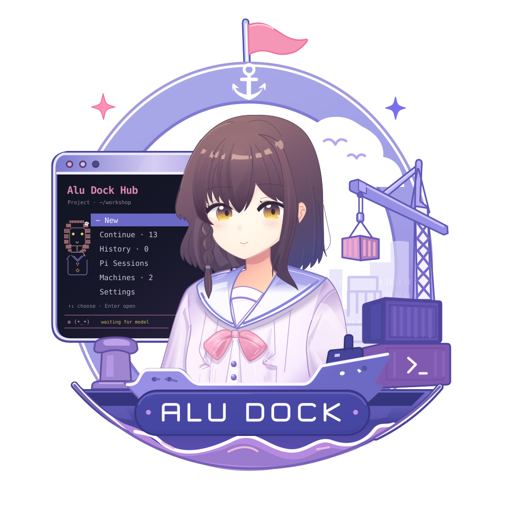

<p align="center">
  
</p>

<h1 align="center">Alu Dock Official Client</h1>

<p align="center">Alu Dock 的官方 Desktop 与 Android Client。</p>

本目录是根 [`Alu Dock`](../../README.md) 产品仓库的一部分。Desktop、Android、TUI 与自定义 Client 都通过同一个 Protocol V2 连接 Host；官方 Client 不直连 Worker，也不维护另一套业务协议。

## 主要功能

- 在多个 Alu Dock 和 Work 之间切换，继续已有对话并查看运行状态
- 发送文字、图片和附件，管理 Queue、Session、模型、Thinking 与 Tools
- Desktop 通过本机 Unix socket 或 Windows Named Pipe 直接连接同一 Host
- Android 与远程 Desktop 通过配对后的 mTLS 连接 Host

## 开发环境

需要 Node.js `>=24.0.0`、Corepack 管理的 pnpm 10、Rust 1.88，以及当前平台的 Tauri 2 构建依赖。从 monorepo 根目录可以运行：

```bash
npm run client:install
npm run client:test        # Vue/TypeScript tests
npm run client:build       # Vue typecheck 与前端产物
npm run client:dev         # 浏览器设计预览
```

进入本目录可以启动真实 Desktop 原生宿主或执行通用 no-bundle 构建：

```bash
corepack pnpm install --frozen-lockfile
corepack pnpm tauri dev
corepack pnpm tauri build --no-bundle --ci
```

Web UI 与文档直接使用根目录的 `assets/icon.svg`。从同一个 SVG 重建 Desktop、移动端图标，并同步 Tauri Android 工程实际消费的资源：

```bash
icon_output="$(mktemp -d)"
corepack pnpm tauri icon ../../assets/icon.svg --output "$icon_output"
cp -R "$icon_output"/. src-tauri/icons/
cp -R "$icon_output"/android/. src-tauri/gen/android/app/src/main/res/
rm -rf "$icon_output"
```

`corepack pnpm dev` 用于浏览器设计预览；本机 socket、文件系统等原生能力需要在具备 Tauri native bridge 的 Desktop 中验证。根 `client:test` / `client:build` 覆盖前端，Rust core 与 Tauri host 的完整 gates 见下文「验证入口」。

### 浏览器验证预览

临时验收、截图和 native IPC fixture 使用仓库统一入口，不另写独立 Vite 服务器：

```bash
cd clients/official
corepack pnpm verify:preview                    # http://127.0.0.1:1422
corepack pnpm verify:preview --port 0           # 自动分配端口并打印地址
corepack pnpm verify:preview --fixture /absolute/path/to/fixture.mjs
corepack pnpm test:preview
```

fixture 文件默认导出一个 Vite 插件，可模拟 native IPC 或注入测试数据；它是附加插件，不能替换项目配置或开启文件监听。入口保留 `vite.config.ts` 的 Vue、资源和构建标识配置，使用独立临时缓存，仅监听本机，关闭文件监听和热更新。**源码变化后重启预览，再刷新页面**；Ctrl-C 关闭服务器并清理临时缓存。需要日常热更新时使用上面的 `pnpm dev`。

2026-09 的重复故障来自独立验证服务器跳过项目配置后扫描 Rust `target`。不要用 `configFile: false` 另起浏览器预览，也不要提高系统 watcher 上限来补救。一次性模块测试若不加载项目配置，必须显式关闭监听；`build()` 不开启文件监听，不受此限制。

## Linux Desktop

安装 Rust/Tauri 编译与打包依赖：

```bash
sudo apt install build-essential cmake libwebkit2gtk-4.1-dev libgtk-3-dev libayatana-appindicator3-dev librsvg2-dev patchelf zip
```

生成可交付的 x86_64 Linux ZIP：

```bash
npm run client:package:linux
```

产物位于 `clients/official/dist/AluDock-<version>-linux-x86_64.zip`。Desktop 默认连接 `${XDG_RUNTIME_DIR}/alu-dock/dock.sock`；没有 `XDG_RUNTIME_DIR` 时使用 `~/.alu-dock/run/dock.sock`。本机连接不需要设备配对。

## Windows Desktop

在原生 x86_64 Windows 开发机安装 Tauri 2 所需的 Microsoft C++ Build Tools、WebView2、Rust MSVC target 与 Corepack 后，从 monorepo 根目录生成统一验收包：

```powershell
npm install
npm run client:install
npm run package:windows
```

Windows 用户入口为 `dist/AluDock-<version>-windows-x86_64-Setup.exe`。源码 checkout 默认使用当前分支可达的最新版本 tag，正式构建可通过 `ALUDOCK_RELEASE_VERSION` 指定。组装保留 bundled Pi、系统 Node 版本检查、native prebuild 修剪及 PE/DLL 闭包检查。`-components.zip` 供后续构建复用 Desktop/DLL；仅 Host/Worker/Pi 改动时无需重编译 Desktop，用户安装仍使用 Setup.exe。

从托盘正常退出 Alu Dock，再运行 Setup，按标准安装器提示安装或覆盖更新。默认程序目录是 `%LOCALAPPDATA%\AluDock`，原有资料保留在 `%LOCALAPPDATA%\Alu Dock`、Pi 和客户端资料目录中。只有启用本机服务才需要符合根 `package.json#engines.node` 的系统 [Node.js](https://nodejs.org/)；纯客户端不需要本机 Node。安装器的工程边界见根[部署文档](../../docs/agent_maps/deployment.md#本地安装与-windows-发行)。

Windows 无配置时默认随客户端启动本机 Dock，可在托盘取消此选项作为纯客户端；本机 Dock 的起停选择独立于当前连接的 Main。X 隐藏到托盘，工作继续；手动 **退出 Alu Dock** 正常停止所管理的本机 Host/Worker 后退出，停止受阻时说明原因并保留界面。**停止本机 Dock** 保留客户端，远端不受影响。托盘显示实际状态及对应操作。登录启动保留既有选择，只打开同一个客户端并遵循本机服务选项。日志仍在 `%LOCALAPPDATA%\Alu Dock\logs\host.log`。

退出应用后使用 Windows Apps 或安装目录中的标准卸载入口；卸载移除程序资源，Dock/Pi 配置、身份、凭据、Session、附件及客户端资料保留在原位置。checkout 的 `npm run install:local` 构建并运行同一个 Setup.exe。
普通开发仍可运行：

```powershell
corepack pnpm tauri dev
corepack pnpm tauri build --no-bundle --ci
```

上述命令用于源码调试和 Client 构建，安装交付统一使用 Setup.exe。Linux cross-check 验证 Windows Rust 分支可编译；原生 DLL、隐藏窗口、tray、login startup、系统 Node、bundled Pi 与完整启动 smoke 按 [`AGENTS.md`](AGENTS.md) 在 Windows 上验证。当前验收包不签名、不发布、不自动更新。

## Android

准备 JDK 17、Android SDK 36 和 `.env.android.example` 所示版本的 Android NDK。机器路径使用该文件的格式，并保存在 `corepack pnpm android config-path` 显示的本机配置位置：

```bash
corepack pnpm android config-path
corepack pnpm android doctor
corepack pnpm android setup
rustup target add aarch64-linux-android
corepack pnpm android build --debug --apk --target aarch64 --ci
```

Debug APK 位于 `src-tauri/gen/android/app/build/outputs/apk/universal/debug/app-universal-debug.apk`。

本机正式签名环境固定为 ignored 的 `.release-secrets/android/signing.env`，并按 [`AGENTS.md`](AGENTS.md) 作为 opaque credentials 处理：只检查文件是否存在及是否被 Git 忽略，不查看或输出其中的密码。只有主人明确授权本机签名构建后，才在短期子 shell 中加载它并立即构建：

```bash
(
  set -a
  source .release-secrets/android/signing.env
  set +a
  corepack pnpm android stg
)
```

`android stg` 只消费已经加载的签名环境变量，不读取 `signing.env`。该命令不发布 Release 或修改 tag，产物位于 `dist/AluDock-<version>-android-arm64-stg.apk`。

## 验证入口

```bash
corepack pnpm check   # Rust 格式、前端测试、core 与 Tauri host 的 Rust 测试
corepack pnpm build   # Vue 类型检查与前端产物
```

两者合起来就是根目录的 `npm run client:check`，与发布检查相同，合并前跑一次；开发中只跑与改动相关的单项。

从 monorepo 根目录运行真实 Host 与官方 Rust core 的 Protocol V2 兼容门：

```bash
npm run test:client-protocol
```

该门只支持 Linux：它隔离启动 production CLI Host，让 Rust core 通过 public local connection 显式选择 Main，只读列出静态 saved session，不采用或恢复 Session。Android/WebView、mTLS、Windows lifecycle 和真机体验需要分别验证。

协议调试工具仍可从 Rust workspace 运行：

```bash
cargo run -p aludock-client-cli -- --help
```

## 目录结构

对话内容、阅读位置、展示组件和样式的职责与定位入口见 [`CONVERSATION_ARCHITECTURE.md`](CONVERSATION_ARCHITECTURE.md)。

```text
crates/aludock-client-core/  配对、Protocol V2 与本地/远程 transport
crates/aludock-client-cli/   协议调试工具
src-tauri/                   Tauri Desktop/Android 原生宿主
src/                         Vue 3 界面
scripts/                     平台开发与本地打包入口
```

Client 专用代码采用 [`LICENSE-APACHE`](LICENSE-APACHE)。产品语义与跨层工程规则以根 [`STORY.md`](../../STORY.md) 和 [`AGENTS.md`](../../AGENTS.md) 为准。
