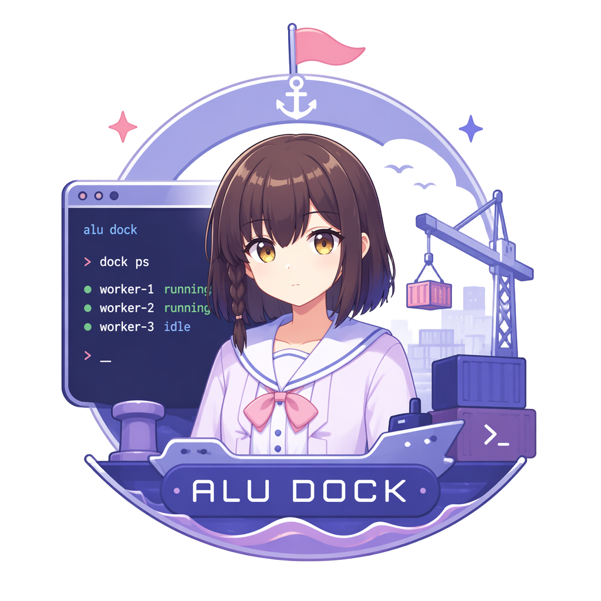

<p align="center">
  
</p>

<h1 align="center">Alu Dock Official Client</h1>

<p align="center">Alu Dock 的官方 Desktop 与 Android Client。</p>

本目录是根 [`Alu Dock`](../../README.md) 产品仓库的一部分。Desktop、Android、TUI 与自定义 Client 都通过同一个 Protocol V2 连接 Host；官方 Client 不直连 Worker，也不维护另一套业务协议。

## 主要功能

- 在多个 Alu Dock 和 Work 之间切换，继续已有对话并查看运行状态
- 发送文字、图片和附件，管理 Queue、Session、模型、Thinking 与 Tools
- Desktop 通过本机 Unix socket 或 Windows Named Pipe 直接连接同一 Host
- Android 与远程 Desktop 通过配对后的 mTLS 连接 Host

## 开发环境

需要 Node.js `>=22.19.0`、Corepack 管理的 pnpm 10、Rust 1.88，以及当前平台的 Tauri 2 构建依赖。从 monorepo 根目录可以运行：

```bash
npm run client:install
npm run client:test        # Vue/TypeScript tests
npm run client:build       # Vue typecheck 与前端产物
npm run client:dev         # 浏览器设计预览
```

进入本目录可以启动真实 Desktop 原生宿主或执行通用 no-bundle 构建：

```bash
corepack pnpm install --frozen-lockfile
corepack pnpm tauri dev
corepack pnpm tauri build --no-bundle --ci
```

`corepack pnpm dev` 只启动浏览器设计预览，不具备 Tauri native bridge，因此不能用来证明本机 socket、文件系统或其他原生能力。根 `client:test` / `client:build` 也只覆盖前端；Rust core 与 Tauri host 的完整 gates 见下文「验证入口」。

## Linux Desktop

安装 Rust/Tauri 编译与打包依赖：

```bash
sudo apt install build-essential cmake libwebkit2gtk-4.1-dev libgtk-3-dev libayatana-appindicator3-dev librsvg2-dev patchelf zip
```

生成可交付的 x86_64 Linux ZIP：

```bash
npm run client:package:linux
```

产物位于 `clients/official/dist/AluDock-<version>-linux-x86_64.zip`。Desktop 默认连接 `${XDG_RUNTIME_DIR}/alu-dock/dock.sock`；没有 `XDG_RUNTIME_DIR` 时使用 `~/.alu-dock/run/dock.sock`。本机连接不需要设备配对。

## Windows Desktop

在原生 x86_64 Windows 开发机安装 Tauri 2 所需的 Microsoft C++ Build Tools、WebView2、Rust MSVC target 与 Corepack 后，从 monorepo 根目录生成统一验收包：

```powershell
npm install
npm run client:install
npm run package:windows
```

产物位于 `dist/AluDock-<version>-windows-x86_64.zip`。组装脚本读取 [`windows-runtime.json`](windows-runtime.json) 固定 Node/npm release 与 checksum，构建 `x86_64-pc-windows-msvc` Desktop，安装 Dock production tree 与 bundled Pi，复制 DLL sidecars，并使用 `dumpbin.exe` 检查随包 PE 架构及依赖后才写 ZIP。也可通过 `ALUDOCK_WINDOWS_NODE_ARCHIVE` 指定已经下载的同一 checksum archive；它不会放宽固定版本。

最终用户完整解压后运行一次 `Setup.cmd`；唯一安装目录是 `%LOCALAPPDATA%\Alu Dock\app`，日常入口是其中的 `AluDock.exe`，随包 TUI/CLI 是 `aludock.cmd`。Setup 和 Desktop 使用同一个 Dock lifecycle：Host 隐藏运行并把日志写到 `%LOCALAPPDATA%\Alu Dock\logs\host.log`；X 隐藏到托盘，**退出 Desktop** 不停止 Host，**停止 Alu Dock** 在 active Work 存在时拒绝。登录启动默认关闭，启用后用 `--background` 静默恢复 Host 和托盘。

普通开发仍可运行：

```powershell
corepack pnpm tauri dev
corepack pnpm tauri build --no-bundle --ci
```

这些是源码调试/Client build，不是第二套安装形态。Linux cross-check 可以证明 Windows Rust 分支可编译，但不能替代 [`AGENTS.md`](AGENTS.md) 要求的原生 DLL、隐藏窗口、tray、login startup、bundled Node/npm/Pi 与完整启动 smoke。当前验收包不签名、不发布、不自动更新。

## Android

准备 JDK 17、Android SDK 36 和 `.env.android.example` 所示版本的 Android NDK。机器路径使用该文件的格式，并保存在 `corepack pnpm android config-path` 显示的本机配置位置：

```bash
corepack pnpm android config-path
corepack pnpm android doctor
corepack pnpm android setup
rustup target add aarch64-linux-android
corepack pnpm android build --debug --apk --target aarch64 --ci
```

Debug APK 位于 `src-tauri/gen/android/app/build/outputs/apk/universal/debug/app-universal-debug.apk`。

本机正式签名环境固定为 ignored 的 `.release-secrets/android/signing.env`，并按 [`AGENTS.md`](AGENTS.md) 作为 opaque credentials 处理：只检查文件是否存在及是否被 Git 忽略，不查看或输出其中的密码。只有主人明确授权本机签名构建后，才在短期子 shell 中加载它并立即构建：

```bash
(
  set -a
  source .release-secrets/android/signing.env
  set +a
  corepack pnpm android stg
)
```

`android stg` 只消费已经加载的签名环境变量，不读取 `signing.env`。该命令不发布 Release 或修改 tag，产物位于 `dist/AluDock-<version>-android-arm64-stg.apk`。

## 验证入口

```bash
corepack pnpm test
corepack pnpm build
cargo test --workspace --locked
cargo test --locked --manifest-path src-tauri/Cargo.toml
cargo fmt --all -- --check
cargo fmt --manifest-path src-tauri/Cargo.toml --all -- --check
```

协议调试工具仍可从 Rust workspace 运行：

```bash
cargo run -p aludock-client-cli -- --help
```

## 目录结构

```text
crates/aludock-client-core/  配对、Protocol V2 与本地/远程 transport
crates/aludock-client-cli/   协议调试工具
src-tauri/                   Tauri Desktop/Android 原生宿主
src/                         Vue 3 界面
scripts/                     平台开发与本地打包入口
```

Client 专用代码采用 [`LICENSE-APACHE`](LICENSE-APACHE)。产品语义与跨仓库工程规则以根 [`STORY.md`](../../STORY.md) 和 [`AGENTS.md`](../../AGENTS.md) 为准。
